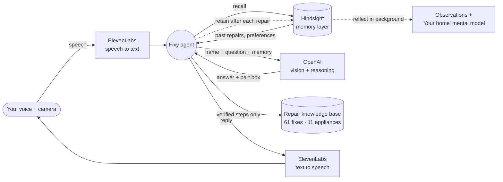

# FixLens: a repair agent that remembers

**Point your phone at what's broken, ask out loud, and Fixy shows you exactly where to fix it. With [Hindsight](https://github.com/vectorize-io/hindsight) as its memory, it also remembers every repair: what broke, what fixed it and what's due next.**

> Every AI assistant forgets. Your washing machine shows "OE" for the second time and you get the same seven-step checklist, even though last month the fix was a clogged drain filter. Fixy remembers, so the second time goes straight to the fix.

---

## What it does

1. **Sees:** point the camera at an appliance or a car's engine bay. Fixy reads error codes and understands the scene.
2. **Listens:** hold the mic and ask, e.g. "My washing machine shows OE again."
3. **Points:** a marker locks onto the exact part (dipstick, drain-filter flap, battery terminal) and stays on it as you move the phone.
4. **Guides:** verified steps one at a time; say "done" for the next one. Dangerous jobs are escalated to a technician.
5. **Remembers (Hindsight):** every repair is retained. Next time, Fixy recalls what happened and starts from what worked.

## Why memory is the core

| | Without memory | With Hindsight memory |
|---|---|---|
| "My washing machine shows OE again" | Step 1 of 7, the generic checklist | "Last month OE on this machine was a clogged drain filter, and cleaning it fixed it. Let's check that first." The marker goes on the filter flap. |
| Weekly oil check | Every check is a fresh start | "Last week it was at the lower mark." A second drop a week later → **pattern → possible leak → see a mechanic** |
| A new home, first repair | Generic checklist | Starts at the fix that works most often across all homes (community bank) |
| "It's too warm in here" | "What temperature would you like?" | "Setting your bedroom AC to 24, the way you like it." |

**Learning curve:** interaction 1 is generic. By interaction 5 it knows your car. By interaction 20 it knows your home.

## Architecture



| Layer | Choice |
|---|---|
| App | Android, Kotlin + Jetpack Compose, CameraX |
| Speech to text / text to speech | ElevenLabs |
| Vision + reasoning (LLM) | OpenAI API |
| Memory | **Hindsight** (retain / recall / reflect, memory banks, mental models) |
| Part tracking | OpenCV optical flow (the marker stays locked as the phone moves) |
| Repair steps | Curated JSON knowledge base, each fix backed by ≥ 2 manufacturers' manuals |
| Reminders | Local alarms + notifications, scheduled from memory |

## How Hindsight is used

### Memory banks

| Bank | Contents |
|---|---|
| `home-<household>` | This home's appliances, brands, faults, fixes, outcomes, preferences |
| `fixy-community` | Anonymous outcomes from all homes: no names, photos or addresses |

A Hindsight **directive** enforces the safety rule: *memory may prioritise or recall, never create new repair steps.* Steps always come from the verified knowledge base.

### Retain: after every repair (async, never blocks the voice)

```python
client.retain(
    bank_id="home-4821",
    content="Engine oil check on the car. Level was at the lower mark; topped up to the upper mark.",
    context="Homeowner repairing with Fixy",
    tags=["car", "engine_oil", "topped_up"],
    document_id=session_id,
)
```

Hindsight extracts facts and entities (car → engine oil → lower mark → 22 Sep) and schedules the next check.

### Recall: before Fixy answers

```python
memories = client.recall(bank_id="home-4821", query="washing machine OE", max_tokens=400)
```

The results go into the prompt next to the knowledge-base entry. Recall also runs at app open, so the greeting is instant ("Last time your washer showed OE…").

### Reflect + mental models: in the background

- `reflect` on `fixy-community` turns outcomes into observations: *"OE on front-loaders is usually a clogged drain filter"* (with evidence counts).
- A **"Your home" mental model** keeps a living profile: appliances, recurring issues, preferences (AC at 24 °C) and what's due next (oil check · Mon 6 Oct).

### What stays local

Camera frames and photos never go to memory; only short text facts do. Reminders are local alarms, so they fire without a network.

## Example session

```
Day 1   You:   How do I check the engine oil?
        Fixy:  [marks the dipstick] … guides step by step
        You:   It's right at the lower mark.
        Fixy:  Let's top it up. I've saved this, and I'll remind you in a week.   ← retain
Day 8   🔔     Engine oil check due. Last week it was at the lower mark.
        Fixy:  Welcome back! Last week your oil was at the lower mark…           ← recall
        You:   It's below the lower mark again.
        Fixy:  That's the second drop in a week. The engine may be leaking or
               burning oil. This one is a job for a mechanic.                  ← pattern from memory
```

## Safety principles

- Repair steps come **only** from the curated knowledge base; the model never invents steps, parts or values.
- Every guide starts with its safety steps (unplug, engine off and cool).
- Technician-only faults (wiring, burning smell, a leak pattern) are escalated, with nearby technicians suggested.

## Repo layout

```
app/src/main/java/com/fixlens/
  camera/    CameraX preview + frame buffer
  vision/    model client, box parsing and mapping
  tracking/  optical-flow tracker that keeps the marker on the part
  voice/     speech in / speech out
  kb/        knowledge base loading + retrieval
  guide/     orchestrator, guided-repair state machine, Fixy prompts
  alerts/    reminders (alarm + notification)
  ir/        IR remote control (Fixy can set the AC)
  ui/        camera screen, marker overlay, cards
tools/kb/    knowledge-base sources and build script
```

## Roadmap

- Hindsight integration: retain/recall/reflect in `guide/` (the memory layer described above)
- A "Your home" screen backed by the mental model
- Hindi / Telugu voices, more appliances

## Links

- Hindsight on GitHub: https://github.com/vectorize-io/hindsight
- Hindsight docs: https://hindsight.vectorize.io/
- What is agent memory: https://vectorize.io/what-is-agent-memory

---

*FixLens: repairs that remember.*
